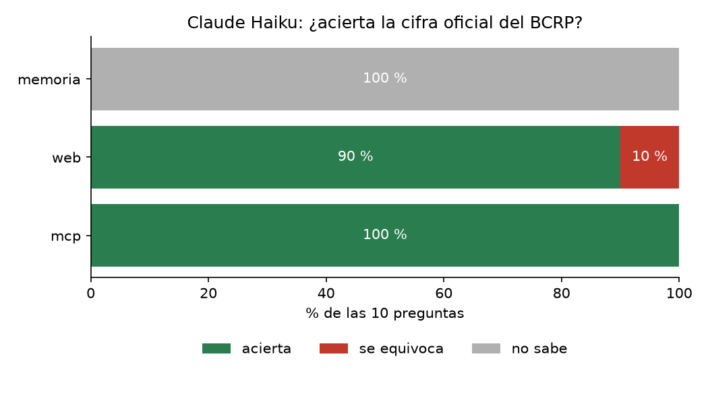

# Informe · ¿Acierta Claude las cifras del BCRP con y sin un MCP?

Corrida del 28 de octubre de 2026 con `claude -p` y Claude Haiku, sobre las 10 preguntas de `preguntas.csv` (8 del
curso y 2 propias). La corrida base (`uv run evaluar.py`) está en `resultados.csv`; el experimento extra
(`uv run evaluar.py --modos memoria web mcp`) está en `resultados_web.csv`.

## Resultados

| Modo | Acierta | Se equivoca | No sabe | Segundos promedio |
|---|---|---|---|---|
| memoria | 0 | 0 | 10 | 5.0 |
| web | 9 | 1 | 0 | 22.6 |
| mcp | 10 | 0 | 0 | 14.2 |

En la corrida base (solo memoria y MCP) el resultado fue el mismo: memoria 0 aciertos y 10 «no sé» (5.3 s), MCP 10 de
10 (15.0 s).

## Qué falló cada modo y por qué

- **Memoria:** respondió «no sé» en las 10. Todas las cifras son de 2025 o 2026 y la instrucción le permite poner
  `null`; Haiku dice en la `fuente` que su conocimiento llega a junio de 2026 y que no tiene herramientas. No inventó
  ninguna cifra.
- **Web:** falló solo `cobre_ago26`: respondió 651 cuando la verdad es 689.70 ¢US$/lb. Leyó otra serie, la del cobre en
  la LME (`PN01652XM`), en vez del precio de exportación (`PN38784BM`). Las dos son «precio del cobre» y la búsqueda web
  no distingue cuál pide la pregunta. En otras cinco preguntas tomó la cifra de medios (Forbes, Infobae, El Comercio)
  que citan al INEI, no del BCRP: acertó, pero redondeada y de segunda mano. Fue el modo más lento (22.6 s), con un
  máximo de 44.7 s en la tasa de referencia.
- **MCP:** acertó las 10 y en todas citó el código de la serie, el periodo y la URL de la API. Es 8 s más rápido que la
  web por pregunta porque `buscar_series` da el código en una llamada y `serie` o `resumen` dan el valor sin decimales
  perdidos. El único punto flojo es `pbi_2025`: en la corrida web respondió 3.4 en vez de 3.43, porque Haiku redondeó
  al decimal que la serie publica; entró en la tolerancia de 0.05.

## Dos cifras comprobadas a mano en la web del BCRP

Las dos preguntas propias se comprobaron en la tabla web del BCRP, no con este MCP:
[PN38063GM y PN38793BM, jul–set 2026](https://estadisticas.bcrp.gob.pe/estadisticas/series/mensuales/resultados/PN38063GM-PN38793BM/html/2026-7/2026-9/).

| Pregunta | Tabla web del BCRP | Lo que dio el MCP |
|---|---|---|
| Tasa de desempleo de Lima Metropolitana, promedio móvil 3 meses, set. 2026 (`PN38063GM`) | 4.4 % | 4.37 % (4.3717 sin redondear) |
| Precio del oro de exportación, ago. 2026 (`PN38793BM`) | 4,411.1 US$/oz troy | 4,411.15 US$/oz troy |

La tabla web publica un decimal; la API da el valor completo, así que la diferencia es solo de redondeo.

## La herramienta propia: `comparar_paises`

El BCRP solo publica datos del Perú. `comparar_paises` consulta la API del Banco Mundial (sin clave) para comparar al
Perú con otros países en seis indicadores con nombre (crecimiento del PBI, inflación, desempleo, PBI per cápita,
exportaciones y deuda pública como % del PBI) o con cualquier código del Banco Mundial. Devuelve los valores por país y
año, qué país tuvo el valor más alto cada año y la URL de la fuente. Por ejemplo, el PBI del Perú creció 3.52 % en 2024 y
3.43 % en 2025, más que Chile (2.81 % y 2.46 %) y Colombia (1.49 % y 2.64 %).

## Conclusión

Sin herramientas, Haiku no inventó cifras cuando se le permitió decir que no sabía, pero tampoco sirvió para nada. La
búsqueda web acierta casi siempre, aunque tarda más, cita medios en vez de la fuente oficial y puede confundir series
con nombres parecidos, como pasó con el cobre. Un MCP vale la pena cuando hay una fuente oficial con API que se consulta
seguido y la cifra tiene que ser exacta y trazable: aquí acertó 10 de 10, más rápido y con el código de cada serie. Para
preguntas ocasionales sobre fuentes sin API, la búsqueda web basta.
